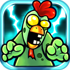

<p align="center">
  
</p>

# CK2: Zombie / 僵尸鸡防卫战

> 一只鸡，一座基地，一场迟到了很多年的防守战。

这是 `com.bluegnc.chickenrevolution2`（CK2: Zombie / Chicken Revolution II）的复活工程。

原版是 32 位 ARM 时代的手游。服务器早就停了，旧版 Google Play 服务也不在了。APK 还能找到，但装到今天的手机上，不是闪退，就是卡在已经连不上的网络请求里。

我们没有打算重做一个“像它”的游戏。我们只是把原来的安装包拆开，尽量让它在今天还能跑起来：

- 把失效的网络入口换成离线返回；
- 重新整理资源索引，让 targetSdk 28 的设备能正常安装；
- 把当年 480×320 的画面接到全面屏上；
- 加了一个很小的设置按钮，可以在“全屏拉伸”和“保持 3:2 原比例 + 左右黑边”之间切换；
- 保留原来的 native 引擎、美术、音效和关卡数据。

它不完美，但那只鸡又能跑了。

## 我们是怎么把它救回来的

### 先让它能装

原包的 `targetSdkVersion` 还停在 9。新系统对安装、native 库解压和明文流量的限制，会让它连第一步都走不过去。

我们重建了资源表，把清单升到 targetSdk 28，打开 `extractNativeLibs`，并重新映射了 DEX 里的资源 ID。这样包能装上了，桌面图标也能正常显示。

### 再让它能进

旧包启动时会去连已经关闭的服务器，还会初始化旧版统计 SDK。网络不通时，它就一直等。

我们保留了 native 引擎，只把两个网络入口改成直接失败，并把 Java 层的统计初始化拿掉。游戏不再等一个永远不会回来的响应，而是继续走本地流程。

### 最后让它像今天的东西

原版画面是 3:2 的。直接拉满全面屏，鸡和僵尸都会变形；留黑边，又会有标题栏和状态栏来捣乱。

所以有了现在这个很小的设置按钮：

- 默认全屏拉伸，适合想铺满屏幕的人；
- 打开“保持原比例”，就是 3:2 + 左右黑边，比例和当年一样。

全屏、刘海区域、标题栏这些，都在 `MainActivity` 和 `SettingsHelper` 里处理。没有改游戏逻辑，只是让它和现在的屏幕好好相处。

## 项目特性

- 横屏沉浸式全屏；
- 可选 3:2 原比例 + 左右黑边；
- 游戏内设置按钮；
- Android 高版本可安装（targetSdk 28）；
- 离线运行所需的网络桩补丁；
- 完整可汇编的 smali、资源、assets 和 native 库。

## 目录结构

```text
app/src/main/
  AndroidManifest.xml      Android 清单（targetSdk 28）
  smali/                   完整可汇编的 smali（构建用）
  res/                     资源（主题、布局、字符串）
  assets/                  游戏资源与数据（图片、音频、字体、.dat）
  lib/armeabi/             原始 32 位 ARM native 库
java-decompiled/           jadx 反编译出的 Java 可读代码（参考用）
tools/                     smali/baksmali 依赖 jar
scripts/build.sh           一键构建
scripts/decompile.sh       重新生成 Java 反编译代码
docs/REVERSE_ENGINEERING.md 逆向与兼容性说明
docs/icon.png              游戏图标
```

## 下载

已构建的 APK：

https://github.com/Winkmoon/CK2-Zombie-Revived/releases/tag/v1.0.2

## 构建

依赖：

- Linux / macOS；
- JDK 8+；
- Android SDK Build-Tools（含 `aapt2`、`zipalign`、`apksigner`）；
- Android Platform `android.jar`（默认使用 `android-37.1`）。

```bash
export ANDROID_SDK=/opt/android-sdk
./scripts/build.sh
```

输出：

```text
dist/CK2-Zombie-Revived.apk
```

首次构建会自动生成 `debug.keystore`（密码 `android`）。发布时请使用自己的签名：

```bash
KEYSTORE=/path/to/release.keystore KS_PASS=*** KEY_PASS=*** \
  ./scripts/build.sh
```

安装：

```bash
adb install -r dist/CK2-Zombie-Revived.apk
```

> 游戏 native 只有 `armeabi`（32 位 ARM）。请使用支持 32 位 ARM 应用的设备/模拟器；纯 arm64 环境无法运行。

## 已做的兼容性修改

- `AndroidManifest.xml`：`targetSdkVersion=28`，允许明文流量，`extractNativeLibs=true`；
- 主题改为 `Theme.Light.NoTitleBar.Fullscreen`，去掉标题栏；
- `MainActivity` 使用沉浸式全屏，并提供“保持原比例（黑边）”开关；
- `OGLView` 使用实际视图尺寸，按 3:2 比例做 letterbox；
- native 的 `isNetwork()` 与 `httpPost()` 返回失败，避免离线时卡在网络请求；
- 资源 ID 重新映射到 aapt2 生成的值（`R$id`、`R$drawable`、`R$string` 等）；
- 移除 Flurry 初始化与统计调用。

## 关于 Java 反编译代码

`java-decompiled/` 由 jadx 从构建后的 `classes.dex` 生成，便于阅读和二次开发；它不是完整的 Gradle 工程，不能直接 `gradle build`。实际可构建的源码是 `smali/`。

重新生成：

```bash
./scripts/decompile.sh
```

## Native 说明

`lib/armeabi/libtestgl-jni.so` 是原版自研 C++/OpenGL 引擎，无法还原为完整 C++ 源码。当前工程保留其二进制，并只做了两处离线补丁：

- `0x233d0`：`isNetwork()` 固定返回 0；
- `0x1bfe8`：`httpPost()` 固定返回 0。

其余逻辑保持原版。

## 写在最后

这个仓库更像是给老游戏留的一盏灯。

它不承诺还原所有已经丢失的内容，也不假装自己是一个新游戏。它只是把还能找到的那部分保存下来，修到可以继续运行、继续读、继续改。

如果哪天你也想起某只鸡，欢迎回来看看。

## 免责声明

本项目仅用于老游戏保存、逆向学习与个人研究。游戏名称、美术、音频、数据及原始代码版权归原权利方（Blue GNC / 相关权利人）所有。请勿用于商业用途或重新分发付费内容。若权利人要求，仓库将删除相关内容。
